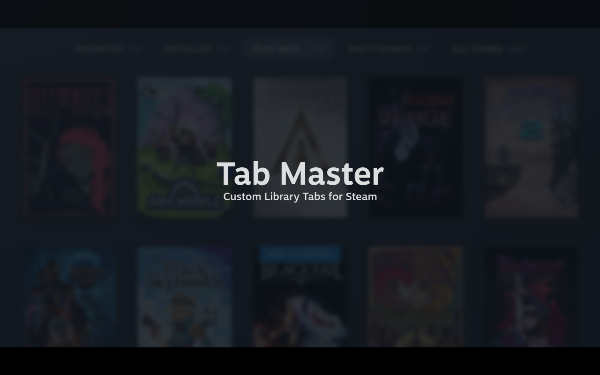

# Tab Master

A plugin for customizing, adding, and removing Library Tabs.

# Overview

TabMaster allows you to have full control over your library tabs! You can hide, filter, reorder them as you please.

# Using the plugin

Once you have installed TabMaster, open it in the Quick Access Menu (QAM), where you can reorder, hide and add tabs!

# Installation

## Decky Store

This is the preferred way to install TabMaster.

### Steps

1. [Install the Decky plugin loader](https://github.com/SteamDeckHomebrew/decky-loader#installation)
2. Use the built in plugin store to download the Tab Master Plugin
    - If you want the bleeding edge version, use Decky's Testing Store

## From Zip

This is the best way to get fixes for TabMaster early if you're having issues

### Steps

1. Go into **Desktop Mode** on your device, and open your preferred browser
2. Go to https://github.com/Tormak9970/TabMaster/releases/latest
3. Download the file `TabMaster_vX.X.X.zip` (ex: `TabMaster_v2.15.0.zip`), and save it somewhere easy to remember
4. Go back to **Game Mode**
5. Open Decky's Settings menu
6. On the **General** tab, scroll down and make sure you have **Developer mode** toggled on
7. Go to the **Developer** tab
8. Click **Install Plugin from ZIP File**, and browse to where you downloaded the zip file earlier

# Features

Features Include: 

- Making custom tabs with editable filters
- Hiding default and custom tabs
- Reordering default and custom tabs

Available Filters:

- **Collection** - Selects apps that are in a certain Steam Collection.
- **Installed** - Selects apps that are installed/uninstalled.
- **Regex** - Selects apps whose titles match a [regular expression](https://medium.com/factory-mind/regex-tutorial-a-simple-cheatsheet-by-examples-649dc1c3f285) (for testing, use [this website](https://regexr.com/)).
- **Friends** - Selects apps that are also owned by any/all listed friends.
- **Tags** - Selects apps that have any/all specific tags.
- **Whitelist** - Selects apps that are added to the list.
- **Blacklist** - Selects apps that are not added to the list.
- **Merge** - Selects apps that pass a subgroup of filters.
- **Platform** - Selects Steam or non-Steam apps.
- **Deck Compatibility** - Selects apps that have a specific Steam Deck compatibilty status.
- **SteamOS Compatibility** - Selects apps that have a specific SteamOS compatibilty status.
- **Review Score** - Selects apps that are greater/less than the provided metacritic/steam review score.
- **Time Played** - Selects apps that have a play time greater/less than the provided time.
- **Size on Disk** - Selects apps that have an install size greater/less than the provided size.
- **Release Date** - Selects apps that were released before/after the provided date.
- **Last Played** - Selects apps that were last played before/after the provided date.
- **Demo** - Selects apps that are/aren't demos.
- **Coming Soon** - Selects apps that are/aren't coming soon.
- **Streamable** - Selects apps that can/can't be streamed from another computer.
- **Steam Features** - Selects apps that support specific Steam Features.
- **MicroSD Card** - Selects apps that are present on the inserted/specific MicroSD Card.
- **Install Folder** - Selects apps that are present on the specific install folder.

If you want us to add another filter, please open a filter request [here](https://github.com/Tormak9970/TabMaster/issues/new/choose).

Filter Examples can be found [here](./docs/FilterExamples.md)

# Contributing

If you're interested in fixing a bug, submitting a new feature, or just helping out, please read the [Contributor Guidelines](./Contributing.md)

## Translations

Know a language? You can help improve TabMaster's translations without writing any code. See [How to help the project by improving a language you know](./docs/Translating.md).

# Credits

**Localisation:**
https://crowdin.com/project/tabmaster
| Language | Translators |  |
| - | - | -: |
| Čeština | | |
| Dansk | | |
| Deutsch | Schneppi, pingpong6004 | |
| Suomi | | |
| Ελληνικά | | |
| Español-España | Sebastian Guardo Lugo | |
| Español-Latinoamérica | | |
| Français | tonymlcz | |
| Italiano | Lemon64k | |
| 日本語 | | |
| 한국어 | | |
| Nederlands | | |
| Polski | | |
| Português | | |
| Português-Brasil | Alberto Eberhardt | |
| Română | | |
| Русский | Vladimir Budylnikov | |
| Svenska | | |
| Türkçe | | |
| Українська | Костя | |
| 简体中文 | Charles Lew | |
| 正體中文 | | |
| Norsk | | |
| ไทย | | |
| Tiếng Việt | | |

## Completion Chart

# Licensing

- This program is licensed under the [GNU General Public License Version 3](https://www.gnu.org/licenses/#GPL) and [BSD 3-Clause License](https://opensource.org/license/bsd-3-clause/)  
- Additionally, please provide appropriate credit for code usage

Copyright Travis Lane (Tormak) and Jessebofill
